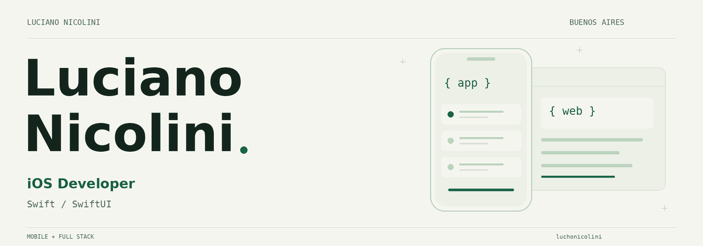

<picture>
  <source media="(prefers-color-scheme: dark)" srcset="assets/profile/header-dark.gif">
  <source media="(prefers-color-scheme: light)" srcset="assets/profile/header-light.gif">
  
</picture>

[Ver cabecera sin animación](assets/profile/header-dark.png)

### Hola, soy Luciano.

Desarrollo apps para iOS con **Swift y SwiftUI**. También trabajo con Flutter y construyo webs y sistemas con Next.js y Supabase.

Tengo mi propio negocio, **[Nicolini Design](https://nicolini-design.vercel.app/)**. Ahí ofrezco desarrollo web, aplicaciones y soluciones a medida. En este perfil comparto tanto ese trabajo como los proyectos que estoy construyendo por mi cuenta.

[Mi web](https://nicolini-design.vercel.app/) · [Escribime](mailto:nicolini.luciano1@gmail.com) · [Ver repositorios](https://github.com/luchonicolini?tab=repositories)

---

## Apps y proyectos

**[DolarToApp](https://github.com/luchonicolini/DolarToApp)** es mi app iOS publicada en App Store para consultar cotizaciones del dólar en Argentina. Está desarrollada con SwiftUI y consume DolarAPI. La destaco porque forma parte de mi experiencia llevando una aplicación a la tienda.

**Puente** nace de una necesidad concreta: ayudar a chicos sordos o con dificultades auditivas a comunicarse con otras personas en situaciones cotidianas. Estoy trabajando en una app que combina texto, mensajes en pantalla y servicios de voz, con el objetivo de darles más autonomía. Está en desarrollo; la parte de IA sigue en modo demostración.

**Gastos Compartidos** es mi forma de resolver las cuentas de un grupo: quién pagó, cuánto le corresponde a cada uno y cómo saldar las deudas. Tiene una versión nativa en SwiftUI y otra en Flutter, con persistencia local y pruebas sobre los cálculos.

**StitchHub** reúne diseños de interfaces con sus prompts y código. Es el proyecto donde trabajo el lado full stack: Next.js, Supabase, perfiles y publicación de contenido.

## Proyectos para recorrer

| Proyecto | Qué vas a encontrar | Stack | Ver |
| --- | --- | --- | --- |
| [DolarToApp](https://github.com/luchonicolini/DolarToApp) | App iOS publicada en App Store para consultar cotizaciones del dólar en Argentina. | SwiftUI · URLSession · Combine · DolarAPI | [COMPLETAR: enlace a DolarToApp en App Store] |
| [Gastos Compartidos · iOS](https://github.com/luchonicolini/Gastos-Compartidos) | Grupos, gastos, balances y liquidaciones. MVVM y tests de lógica. | SwiftUI · SwiftData · XCTest | [COMPLETAR: enlace de publicación iOS si existe] |
| [Gastos Compartidos · Flutter](https://github.com/luchonicolini/Gastos-Compartidos-Flutter) | Multimoneda, dinero en centavos y datos locales. | Flutter · Dart · Drift | [COMPLETAR: enlace de publicación Android si existe] |
| [StitchHub](https://github.com/luchonicolini/StitchHub) | Galería de diseños, perfiles y publicación autenticada. | Next.js · TypeScript · Supabase | [Demo](https://stitch-hub-one.vercel.app) |
| [Puente](https://github.com/luchonicolini/Puente_Flutter) | Comunicación accesible por texto y servicios de voz. | Flutter · Dart · STT/TTS | [COMPLETAR: demo instalable o publicación de Puente si existe] |
| [Scriptor Digital](https://github.com/luchonicolini/scriptor-digital) | Sitio de servicios con formularios validados en cliente y servidor. | Next.js · TypeScript · Zod | [Web](https://scriptordigital.vercel.app/) |

## Nicolini Design

Mi negocio de diseño y desarrollo de webs, apps y soluciones digitales. La web presenta landing pages, sitios multipágina, tiendas online y sistemas a medida.

Trabajo con una idea simple: dejar claro qué se va a construir antes de empezar y mostrar una versión navegable para revisarla. El sitio está hecho con **Next.js, React, TypeScript y Tailwind CSS**.

[Visitar el sitio](https://nicolini-design.vercel.app/) · [Ver el código](https://github.com/luchonicolini/Nicolini-Design)

## Mi caja de herramientas

| iOS | Mobile | Web y backend | Pruebas |
| --- | --- | --- | --- |
| Swift · SwiftUI · UIKit | Flutter · Dart | TypeScript · React · Next.js | XCTest · flutter_test |
| SwiftData · Core Data | Drift / SQLite | Supabase | Playwright · GitHub Actions |

## Experiencia

**Nicolini Design · Emprendimiento propio**

Diseño y desarrollo de sitios web, aplicaciones y soluciones digitales a medida.

[COMPLETAR: experiencia previa o trabajos con clientes]

## A few words in English

I'm Luciano, an iOS developer based in Buenos Aires, Argentina.
I build apps with Swift and SwiftUI, and also work with Flutter, Next.js and Supabase.
I run Nicolini Design, my web and app development business.
Here you'll find my projects, their code and the decisions behind them.

---

¿Tenés una app o una web en mente? [Podemos hablar](mailto:nicolini.luciano1@gmail.com).

iOS Developer (Swift, SwiftUI) · Full Stack (Next.js, Supabase)
